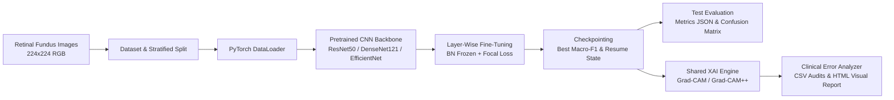
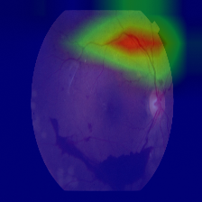
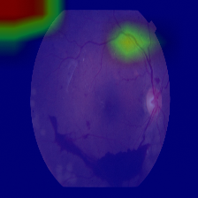

# Medical AI Platform

[](https://www.python.org/)
[](https://pytorch.org/)
[](https://www.kaggle.com/datasets/sovitrath/diabetic-retinopathy-224x224-2019-data)
[](#explainability--clinical-error-analysis)
[](LICENSE)

A modular, experiment-driven medical imaging platform focused on **5-class Diabetic Retinopathy (DR) severity grading** using deep transfer learning, class-imbalance mitigation, **Grad-CAM / Grad-CAM++** visual explainability, and systematic clinical error analysis.

> **Disclaimer:** This project is developed strictly for research and educational purposes. The trained models are not cleared for clinical diagnosis and must not replace evaluation by qualified medical professionals.

---

## Key Highlights

-   **Modular Platform Architecture:** Clean separation between reusable infrastructure (`shared/`) and disease-specific modules (`modules/diabetic_retinopathy/`), designed to scale across additional medical imaging tasks.
-   **Controlled Experimentation (9 Documented Runs):** Incremental ablations across backbones (`EfficientNet-B0`, `ResNet50`, `DenseNet121`), layer-wise fine-tuning depth, BatchNorm freezing, Focal Loss ($\gamma = 2.0$), and inverse-frequency `WeightedRandomSampler` — all logged in [`docs/`](docs/).
-   **Strong Clinical Screening Performance:** Best model (`ResNet50_layer3_layer4_ft_bn_frozen_focal`) achieves **84.17% Test Accuracy**, **0.70 Macro F1**, **0.898 Quadratic Weighted Kappa (QWK)**, and **93.6% Sensitivity / 94.7% Specificity** on Referable DR (`Moderate` or higher).
-   **Counterfactual Explainability & Error Auditing:** Reusable `GradCAM` and `GradCAMPlusPlus` engines that generate both predicted-class and true-class (counterfactual) overlays on misclassified scans, plus an automated HTML inspection report isolating high-confidence and under-diagnosis errors.

---

## System Architecture



---

## Dataset

This project uses the **[Diabetic Retinopathy 224x224 (2019 Data)](https://www.kaggle.com/datasets/sovitrath/diabetic-retinopathy-224x224-2019-data)** dataset from Kaggle (a pre-resized $224 \times 224$ version of the APTOS 2019 Blindness Detection retinal fundus imaging dataset).

-   **Source:** [Kaggle — Diabetic Retinopathy 224x224 (2019 Data)](https://www.kaggle.com/datasets/sovitrath/diabetic-retinopathy-224x224-2019-data)
-   **Processed Metadata:** `data/processed/diabetic_retinopathy/image_metadata.csv`
-   **Additional Notes:** [`docs/dataset.md`](docs/dataset.md)
-   **Split Strategy:** Stratified Train / Validation / Test split preserving the natural class imbalance across all five DR severity grades.

### Class Distribution (Test Set: 733 Retinal Scans)

The strong class imbalance is a primary challenge addressed throughout the experiments (via Focal Loss, inverse-frequency sampling, and Macro F1 model selection).

| Label | Class Name           | Clinical Severity                           | Test Support |  Share   |
| :---: | :------------------- | :------------------------------------------ | :----------: | :------: |
|  `0`  | **No DR**            | No diabetic retinopathy                     |     361      |  49.2%   |
|  `1`  | **Mild**             | Mild non-proliferative DR                   |      74      |  10.1%   |
|  `2`  | **Moderate**         | Moderate non-proliferative DR _(Referable)_ |     200      |  27.3%   |
|  `3`  | **Severe**           | Severe non-proliferative DR _(Referable)_   |      39      |   5.3%   |
|  `4`  | **Proliferative DR** | Proliferative DR _(Referable)_              |      59      |   8.0%   |
|   —   | **Total**            | —                                           |   **733**    | **100%** |

---

## Benchmark Results

Model selection prioritizes **Validation Macro F1** alongside overall accuracy to prevent majority-class collapse.

| Experiment        | Model Configuration                                 |  Test Acc  | Macro F1 |  No DR   |   Mild   | Moderate |  Severe  | Prolif. DR |              Report              |
| :---------------- | :-------------------------------------------------- | :--------: | :------: | :------: | :------: | :------: | :------: | :--------: | :------------------------------: |
| Exp 06            | `EfficientNet-B0`                                   |   71.90%   |   0.40   |    —     |    —     |    —     |    —     |     —      | [Details](docs/experiment-06.md) |
| **Exp 07 (Best)** | **`ResNet50_layer3_layer4_ft_bn_frozen_focal`**     | **84.17%** | **0.70** | **0.98** | **0.66** |   0.79   |   0.47   |  **0.59**  | [Details](docs/experiment-07.md) |
| Exp 08            | `ResNet50_layer3_layer4_ft_bn_frozen_focal_sampler` |   84.04%   |   0.70   |   0.98   |   0.63   | **0.80** | **0.48** |    0.59    | [Details](docs/experiment-08.md) |
| Exp 09            | `DenseNet121_denseblock4_ft_focal`                  |   75.03%   |   0.58   |   0.97   |   0.57   |   0.63   |   0.32   |    0.41    | [Details](docs/experiment-09.md) |

_(Earlier baseline ablations for ResNet50 classifier-only and `layer4` fine-tuning are documented in [`docs/experiment-01.md`](docs/experiment-01.md) through [`docs/experiment-05.md`](docs/experiment-05.md).)_

### Clinical Screening Metrics (Best Model)

Derived from the 733-sample test confusion matrix:

| Clinical Metric                               |   Score   | Notes                                                           |
| :-------------------------------------------- | :-------: | :-------------------------------------------------------------- |
| **Quadratic Weighted Kappa (QWK)**            | **0.898** | Standard ordinal agreement metric for DR grading                |
| **Referable DR Sensitivity** ($\ge$ Moderate) | **93.6%** | 279 / 298 referable cases correctly flagged                     |
| **Referable DR Specificity** (No DR / Mild)   | **94.7%** | 412 / 435 non-referable cases correctly cleared                 |
| **Adjacent-Class Error Share**                | **73.3%** | 85 / 116 total errors occur between neighboring severity grades |

<details>
<summary><strong>View Best Model Confusion Matrix (Test Set)</strong></summary>

```text
True \ Pred       No DR   Mild   Moderate   Severe   Prolif. DR
No DR               353      7          1        0            0
Mild                  4     48         21        0            1
Moderate              1     15        170        9            5
Severe                0      0         17       17            5
Proliferative DR      1      2         20        7           29
```


</details>

---

## Explainability & Clinical Error Analysis

Beyond aggregate accuracy, the platform runs a dedicated **Grad-CAM / Grad-CAM++** audit over a balanced 50-image diagnostic sample set (`10 images per class`) to investigate _where_ the model focuses and _why_ misclassifications occur.

### Audit Findings (50 Balanced Diagnostic Samples)

-   **Overall Sample Accuracy:** `35 / 50 (70.0%)`
-   **Dominant Failure Mode — Under-Diagnosis:** `11 / 15` errors (`73.3%`) under-predict disease severity, primarily `Severe → Moderate` (4 cases) and `Proliferative DR → Moderate` (3 cases).
-   **Confidence Separation:** `14 / 15` errors occur below `0.80` confidence, supporting a confidence/entropy-based **specialist review triage threshold** during deployment.
-   **High-Confidence Error Case Study (`sample_034.png`):** True label `Proliferative DR`, predicted `Severe` with **96.01% confidence** (`P(Proliferative DR) = 2.70%`). Comparing the predicted-class CAM against the counterfactual true-class CAM highlights the exact retinal regions driving the misclassification:

|                 Original Fundus                  |             Predicted CAM (`Severe`, 96.0%)              |          Counterfactual True-Class CAM (`Proliferative DR`)          |
| :----------------------------------------------: | :------------------------------------------------------: | :------------------------------------------------------------------: |
|  |  |  |

Running `analyze_gradcam.py` exports structured CSV breakdowns (`all_errors.csv`, `high_confidence_errors.csv`, `under_diagnosis_errors.csv`) along with an offline interactive HTML inspection dashboard (`error_report.html`).

---

## Project Structure

```text
medical-ai-platform/
├── app/                                  # FastAPI serving layer (API, schemas, services, DB)
├── data/
│   ├── raw/                              # Downloaded Kaggle dataset (gitignored)
│   ├── processed/diabetic_retinopathy/   # Stratified metadata CSV
│   └── samples/diabetic_retinopathy/     # Balanced diagnostic samples for XAI audits
├── docs/                                 # Dataset notes, experiment-01..09 logs & visual assets
├── mlops/                                # Docker & deployment configuration
├── modules/
│   └── diabetic_retinopathy/
│       ├── artifacts/                    # Checkpoints (gitignored), metrics, plots, XAI logs
│       ├── configs/                      # YAML configs (data, model, training)
│       ├── datasets/                     # Dataset & DataLoader factories
│       ├── evaluation/                   # CLI test-set evaluation script
│       ├── explainability/               # Grad-CAM++ runner & clinical error analyzer
│       ├── inference/                    # Decoupled production predictor
│       ├── models/                       # ResNet50, DenseNet121, EfficientNet-B0
│       ├── training/                     # Trainer, engine, Focal Loss, checkpoint resuming
│       └── transforms/                   # Training & evaluation image pipelines
├── notebooks/                            # Exploratory data analysis & training notebooks
├── shared/                               # Reusable platform components
│   ├── datasets/                         # Splitting utilities
│   ├── evaluation/                       # Generic classification evaluator
│   ├── explainability/                   # Reusable GradCAM, GradCAM++, overlay renderer
│   ├── metrics/                          # Classification metrics
│   └── visualization/                    # Confusion matrix plotting
├── tests/                                # Automated test suite (pytest)
├── pyproject.toml
├── requirements-train.txt
└── requirements-serve.txt
```

---

## Getting Started

### 1. Environment Setup

```bash
git clone https://github.com/mjavadzare/medical-ai-platform.git
cd medical-ai-platform

python -m venv venv
# Windows:
venv\Scripts\activate
# Linux / macOS:
# source venv/bin/activate

pip install -r requirements-train.txt
pip install -e . --no-build-isolation
```

### 2. Prepare the Dataset

Download the **[Diabetic Retinopathy 224x224 (2019 Data)](https://www.kaggle.com/datasets/sovitrath/diabetic-retinopathy-224x224-2019-data)** archive from Kaggle and extract it under `data/raw/`. Metadata splits are tracked in `data/processed/diabetic_retinopathy/image_metadata.csv`.

### 3. Training

```bash
python -u -m modules.diabetic_retinopathy.training.train
```

Training automatically manages checkpoints:

-   `<ModelName>_best_model.pth` — Saved at the highest Validation Macro F1.
-   `<ModelName>_last_checkpoint.pth` — Stores full epoch, model, optimizer, and scheduler state for seamless resuming.

### 4. Evaluation

```bash
python -u -m modules.diabetic_retinopathy.evaluation.evaluate \
    --model-name ResNet50_layer3_layer4_ft_bn_frozen_focal \
    --checkpoint-type best
```

### 5. Grad-CAM++ Explainability & Error Analysis

```bash
# Generate Grad-CAM++ heatmaps, overlays, and counterfactual maps for misclassifications
python -u -m modules.diabetic_retinopathy.explainability.gradcam_runner \
    --method gradcam++ \
    --layer layer4

# Run clinical error audit & build interactive HTML inspection report
python -u -m modules.diabetic_retinopathy.explainability.analyze_gradcam
```

---

## Roadmap

-   [x] Modular PyTorch training, resume checkpointing, and 9 controlled model experiments
-   [x] Shared `GradCAM` / `GradCAM++` engine with counterfactual error overlays and HTML audit report
-   [ ] Decoupled inference service (`DRPredictor`) with Temperature Scaling calibration (ECE reduction) & specialist triage flags
-   [ ] Production **FastAPI** service (`/health`, `/api/v1/dr/predict`, `/api/v1/dr/explain`, `/api/v1/dr/history`) with SQLAlchemy audit logging
-   [ ] Containerized deployment via **Docker** & **Docker Compose** (lightweight CPU serving image)
-   [ ] Automated **pytest** suite & **GitHub Actions** CI workflow (`ruff` + `pytest`)

---

## License

This project is licensed under the MIT License — see the [LICENSE](LICENSE) file for details.
